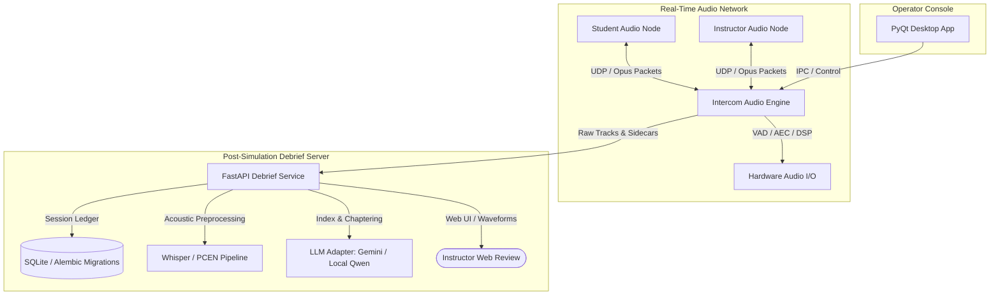

# 🎙️ Real-Time Audio Intercom & AI Simulation Debriefing Platform

[](https://www.python.org/)
[](https://fastapi.tiangolo.com/)
[](https://opus-codec.org/)
[](https://github.com/snakers4/silero-vad)
[](https://www.qt.io/)
[](https://alembic.sqlalchemy.org/)
[](https://openai.com/research/whisper)
[](https://docs.pytest.org/)

A mission-critical, low-latency audio intercom and AI-driven simulation debriefing ecosystem designed for clinical simulation centers, training laboratories, and multi-node operator setups.

---

## 🌟 Core System Pillars

### 1. Low-Latency Real-Time Audio Intercom (`paket1` & `shared`)
- **Opus Compressed Streaming**: High-fidelity, low-bandwidth voice streaming with sub-20ms packetization.
- **Dynamic Port Negotiation**: Automated discovery and dynamic UDP port probing (range 4995-5015) preventing port conflicts.
- **LAN Auto-Discovery**: Zero-configuration peer discovery across local area networks.
- **DSP Audio Pipeline**:
  - **Silero VAD (ONNX)** for high-precision voice activity detection.
  - **Acoustic Echo Cancellation (AEC)** and denoiser filters.
  - **WASAPI / PortAudio Integration** ensuring glitch-free audio on Windows and cross-platform devices.

### 2. AI Simulation Debriefing Platform (`debrief`)
- **FastAPI Web Service**: High-throughput REST API managing session tracks, multi-camera feeds, and transcription segments.
- **Synchronized Timeline Player**: Multi-angle video playback synchronized with real-time audio waveforms and speaker transcripts.
- **Cue & Chapter Bookmarks**: Smart cue detection enabling instructors to bookmark critical medical scenario moments with verification stamps.
- **LLM-Powered Indexing & Evaluation**:
  - Multi-backend LLM integration supporting both cloud models (**Google Gemini**) and local models (**Qwen / llama.cpp**) for automated clinical debrief evaluation.
  - Privacy-preserving data scrubbing removing clinical identifiers before model inference.
- **Alembic Database Architecture**: 13 progressive database migrations ensuring full traceability and resumable background indexing jobs.

### 3. Medical ASR & Audio Preprocessing (`paket3_asr`)
- **Acoustic Enhancement Front-End**:
  - Per-Channel Energy Normalization (**PCEN**) for dynamic gain adaptation under varying microphone distances.
  - Weighted Prediction Error (**WPE**) dereverberation and adaptive spectral alpha filtering.
- **Whisper & ONNX Evaluation Harness**: Rigorous Word Error Rate (WER) and medical term preservation benchmarking.

### 4. Desktop Operator GUI (`paket5`)
- Modern **PyQt / PySide** desktop dashboard providing instructors and room operators with live VU meters, channel volume mixing, push-to-talk, and recording controls.

---

## 🏗 System Architecture



---

## 📁 Repository Structure

```
simclever-intercom/
├── debrief/               # Post-simulation debrief web platform
│   ├── asr/               # Speech-to-text adapters
│   ├── llm/               # Gemini and Local Qwen LLM adapters
│   ├── web/               # Responsive HTML5/JS multi-stream timeline player
│   ├── api.py             # FastAPI routing and endpoints
│   ├── indexing.py        # Automated scenario chaptering & event indexing
│   ├── models.py          # SQLAlchemy ORM entities
│   └── privacy.py         # Anonymization & PII filters
│
├── paket1/                # Core socket & UDP streaming audio nodes
│   ├── student_node.py    # Student station transmitter/receiver
│   └── teacher_node.py    # Instructor console transmitter/receiver
│
├── paket2/                # Audio testing and routing utilities
├── paket3_asr/            # Advanced ASR and DSP preprocessing research
│   ├── config/            # Audio filter and experiment YAMLs
│   ├── scripts/           # PCEN, WPE, and alpha-filter evaluation scripts
│   └── tests/             # ASR pipeline validation tests
│
├── paket5/                # Modern PyQt desktop operator client
│   ├── ui_main.py         # Operator interface and audio mixer
│   └── ui_settings.py     # Audio device configuration modal
│
├── shared/                # Common core libraries
│   ├── core/              # AEC, VAD (Silero ONNX), Codec (Opus), Audio I/O
│   ├── events/            # In-process asynchronous event bus
│   ├── logging/           # High-performance structured logging
│   └── recording/         # Multi-channel lossless session recorder
│
├── migrations/            # Alembic database migrations (0001 - 0013)
├── tests/                 # Unit & integration test suites
├── deploy/                # Docker Compose configurations
├── run_debrief.py         # Entrypoint for debrief platform
├── run_intercom_p5.py     # Entrypoint for desktop GUI client
├── requirements.txt       # Unified Python dependencies
└── .env.example           # Environment template
```

---

## 🚀 Getting Started

### 1. Prerequisites
- Python 3.11+
- Windows (with WASAPI) or Linux (with ALSA/PulseAudio)
- PortAudio / Opus runtime libraries (provided or installed via package manager)

### 2. Quick Setup
Clone the repository and install dependencies:
```bash
git clone https://github.com/cerenkuk/simclever-intercom.git
cd simclever-intercom
python -m venv venv
# On Windows:
.\venv\Scripts\activate
# On Linux/macOS:
source venv/bin/activate

pip install -r requirements.txt
```

### 3. Environment Variables
Copy and configure the environment settings:
```bash
cp .env.example .env
```

### 4. Running the Applications

**Run the Debrief Web Platform:**
```bash
python run_debrief.py
# Access dashboard at http://localhost:8000
```

**Run the Operator Desktop GUI:**
```bash
python run_intercom_p5.py
```

---

## 🧪 Running Automated Tests

Run the full Pytest test suite across all debrief, ASR, and GUI modules:
```bash
pytest tests/ -v
```

---

## 🔒 Security & Portability

- **Zero Hardcoded Secrets**: Cloud API keys (Gemini) and database connections are loaded purely from environment variables.
- **Lightweight & Clean**: Model weights and multi-gigabyte media datasets are excluded to ensure fast cloning and clean continuous integration.
- **Fail-Safe Operation**: Automatic fallback mechanisms across audio ports, codecs, and offline mock adapters.

---

## 👩‍💻 Author & Contributions

- **Ceren Kük** — Audio engine implementation, ASR front-end preprocessing pipeline, FastAPI debrief architecture, and PyQt operator interface.
