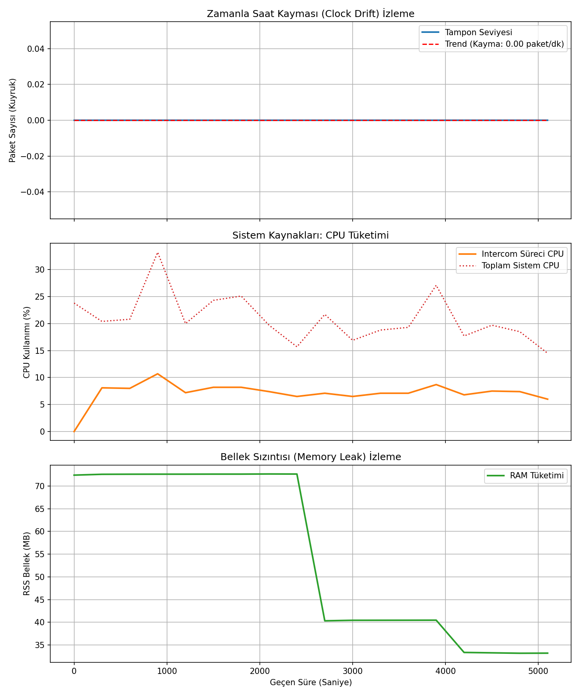

# Drift ve Sistem Kaynakları Analiz Raporu

*   **Ölçüm Süresi:** 5100.0 saniye
*   **Log Sıklığı:** 300.0 saniye

## 1. Saat Kayması (Clock Drift)
*   **Başlangıç Kuyruk Boyutu:** 0 paket
*   **Bitiş Kuyruk Boyutu:** 0 paket
*   **Net Fark:** 0 paket
*   **Analiz:** Kuyruğun büyümesi/küçülmesi, iki bilgisayar arasındaki ses kartı frekans farkını gösterir. Grafik üzerindeki trend çizgisi eğilim yönünü verir.

## 2. CPU Tüketim Analizi
*   **Ortalama İşlemci Kullanımı:** %7.14
*   **Maksimum İşlemci Kullanımı:** %10.70
*   **Hedef Uyum Durumu:** %15 limitinin altındadır.

## 3. Bellek Sızıntısı (Memory Leak) Kontrolü
*   **Başlangıç RAM Kullanımı:** 72.41 MB
*   **Bitiş RAM Kullanımı:** 33.19 MB
*   **Bellek Artışı:** -39.21 MB
*   **Analiz:** Bellek artışının 1.0 MB sınırında kalması, uygulamada belirgin bir bellek sızıntısı olmadığını gösterir.

## Grafikler

